  

  
  
  

<a href="https://github.com/Tommfnr">🇫🇷 Français</a> · <b>🇬🇧 English</b>

## 👋 Hi, I'm Tom

I've been a student at **42 Lyon** since 2024. The school has no lectures: you learn by building projects and by reviewing other students' work.

I like **building complete applications**, from the interface down to the server that runs them in production. I also like going lower level: **threads, sockets, algorithms**.

- 🚀 **Right now:** I maintain a web application **in production** for a non-profit
- 🎓 **At 42:** ft_transcendence, the final project of the core curriculum, built by a team of 5
- 🧩 **What I enjoy:** algorithmic puzzles and concurrency problems
- 🎯 **Looking for:** an internship, a work-study position or a first developer role

---

## 🚀 Featured projects

### 🤝 PEP, peer-to-peer lending
> *ft_transcendence · final project of the 42 core curriculum · team of 5*

A platform where members of the same group lend each other objects, putting **the social connection before the transaction**.

      

- 🧑‍💼 **Product Owner** and full-stack developer, co-author of the concept
- ⚡ **Real-time chat**, my main part:
  - Socket.IO gateway with JWT authentication
  - one room per user, so all their tabs and devices are reached
  - reconnection with a refreshed token
  - catch-up on missed messages
- 📦 Object catalog (pagination, sorting), profiles, groups and client-side error handling
- 🏗️ Microservices architecture: **about 15 containers**, close to **100 branches**, pull-request workflow

### 📅 Volunteer scheduling for a non-profit
> *Client project · in production · used every day*

A web application that runs a non-profit's yearly schedule: sessions, attendance, evening managers, exports and **GDPR compliance**.

     

- 🧱 Designed as a **multi-client template**: one container, database, domain and deploy repository per client
- 🌍 **Deployment:** OVH VPS, Docker Compose, Nginx reverse proxy, HTTPS with Let's Encrypt and automatic renewal
- ✅ **Reliability:**
  - functional tests against every client on each deploy
  - pixel-by-pixel visual regression tests
  - database backups
  - monitoring with Discord alerts

---

## 🧩 Concurrency and algorithmic puzzles

<table>
<tr>
<td width="50%" valign="top">

### 🍝 Philosophers
*C · pthreads · mutexes*

The **dining philosophers** problem: philosophers share forks around a table. They must eat, sleep and think **without ever deadlocking** and without starving.

- 🧵 One thread per philosopher, one mutex per fork
- 🔓 Non-blocking fork pickup, which **prevents deadlock**
- ⏱️ Synchronized start for all threads, then a staggered start to prevent starvation
- 🛡️ All shared data protected, deaths detected and a clean shutdown

</td>
<td width="50%" valign="top">

### 🔢 push_swap
*C · algorithms*

Sort a list of numbers using **two stacks** and a very limited set of operations, **in as few moves as possible**.

- 🧮 **Cost-based** algorithm: for each element, I evaluate the 4 rotation combinations of both stacks
- 🎯 The program always plays the cheapest move
- 🧪 Verified with the official checker

</td>
</tr>
</table>

## ⚙️ Systems and networking

<table>
<tr>
<td width="50%" valign="top">

### 🌐 Webserv
*C++98 · sockets · HTTP/1.1*

A **non-blocking** web server with no external libraries, configured like Nginx. Team project.

My part: request handling, error pages, autoindex, redirects, POST and query strings.

🔗 [mangojus/webserv](https://github.com/mangojus/webserv)

</td>
<td width="50%" valign="top">

### 🧪 [Webserv42_tester](https://github.com/Tommfnr/Webserv42_tester)
*Python · zero dependencies*

A tool that sets up the test environment by itself and runs **more than 100 HTTP tests** against a Webserv.

Other 42 students use it to **break their server before evaluation**.

</td>
</tr>
<tr>
<td width="50%" valign="top">

### 🐳 Inception
*Docker · Nginx · MariaDB*

A WordPress infrastructure built **without any ready-made image**: NGINX (TLS 1.2/1.3), WordPress + php-fpm and MariaDB, each built from Alpine, with a private network and persistent volumes.

</td>
<td width="50%" valign="top">

### 🎮 [Cub3D](https://github.com/Tommfnr/Cub3D)
*C · raycasting*

A **raycasting** 3D engine inspired by Wolfenstein 3D, with textured walls and real-time movement.

</td>
</tr>
</table>

---

## 🛠️ Tech stack

    
    
  

---

  <i>Got a project or an open position? I'm open to opportunities: internship, work-study or a first developer role.</i>

