  

  
  
  

<b>🇫🇷 Français</b> · <a href="https://github.com/Tommfnr/Tommfnr/blob/main/README.en.md">🇬🇧 English</a>

## 👋 Salut, moi c'est Tom

Je suis étudiant à **42 Lyon** depuis 2024. Là-bas, pas de cours : on apprend en construisant des projets et en corrigeant ceux des autres.

J'aime **construire des applis complètes**, de l'interface jusqu'au serveur qui les fait tourner en production. J'aime aussi descendre plus bas : **threads, sockets, algorithmes**.

- 🚀 **En ce moment :** je maintiens une application web **en production** pour une association
- 🎓 **À 42 :** ft_transcendence, le projet final du tronc commun, réalisé en équipe de 5
- 🧩 **Ce qui me plaît :** les casse-têtes algorithmiques et les problèmes de concurrence
- 🎯 **Je cherche :** un stage, une alternance ou un premier poste de développeur

---

## 🚀 Projets phares

### 🤝 [PEP, Prêt Entre Particuliers](https://github.com/Tommfnr/Transcendence)
> *ft_transcendence · projet final du tronc commun 42 · équipe de 5*

Une plateforme pour se prêter des objets entre membres d'un même groupe, où **le lien entre les gens compte avant la transaction**.

      

- 🧑‍💼 **Product Owner** et développeur full-stack, co-auteur du concept
- ⚡ **Chat en temps réel**, ma partie principale :
  - gateway Socket.IO avec authentification JWT
  - une room par utilisateur, pour joindre tous ses onglets et appareils
  - reconnexion avec un token rafraîchi
  - rattrapage des messages manqués
- 📦 Catalogue d'objets (pagination, tri), profils, groupes et gestion des erreurs côté client
- 🏗️ Architecture microservices : **environ 15 conteneurs**, près de **100 branches**, workflow par pull requests

### 📅 Planning de bénévoles pour une association
> *Projet client · en production · utilisé tous les jours*

Une application web qui gère le planning annuel d'une association : sessions, présences, responsables de soirée, exports et **conformité RGPD**.

     

- 🧱 Conçue comme un **template multi-clients** : un conteneur, une base, un domaine et un dépôt de déploiement par client
- 🌍 **Mise en production :** VPS OVH, Docker Compose, reverse proxy Nginx, HTTPS avec Let's Encrypt et renouvellement automatique
- ✅ **Fiabilité :**
  - tests fonctionnels sur chaque client à chaque déploiement
  - tests de non-régression visuelle pixel par pixel
  - sauvegardes de la base
  - monitoring avec alertes Discord

---

## 🧩 Concurrence et casse-têtes algorithmiques

<table>
<tr>
<td width="50%" valign="top">

### 🍝 Philosophers
*C · pthreads · mutex*

Le problème du **dîner des philosophes** : des philosophes partagent des fourchettes autour d'une table. Ils doivent manger, dormir et penser **sans jamais se bloquer** et sans mourir de faim.

- 🧵 Un thread par philosophe, une mutex par fourchette
- 🔓 Prise des fourchettes non bloquante, ce qui **évite l'interblocage**
- ⏱️ Départ synchronisé de tous les threads, puis départ décalé pour éviter la famine
- 🛡️ Toutes les données partagées protégées, mort détectée et arrêt propre

</td>
<td width="50%" valign="top">

### 🔢 push_swap
*C · algorithmique*

Trier une liste de nombres avec **deux piles** et un jeu d'opérations très limité, **en un minimum de coups**.

- 🧮 Algorithme par **calcul de coût** : pour chaque élément, j'évalue les 4 combinaisons de rotations des deux piles
- 🎯 Le programme joue à chaque fois le mouvement le moins cher
- 🧪 Vérifié avec le checker officiel

</td>
</tr>
</table>

## ⚙️ Systèmes et réseau

<table>
<tr>
<td width="50%" valign="top">

### 🌐 [Webserv](https://github.com/Tommfnr/Webserv)
*C++98 · sockets · HTTP/1.1*

Un serveur web **non bloquant**, sans bibliothèque externe et configurable comme Nginx. Projet d'équipe.

Ma partie : le traitement des requêtes, les pages d'erreur, l'autoindex, les redirections, POST et les query strings.

</td>
<td width="50%" valign="top">

### 🧪 [Webserv42_tester](https://github.com/Tommfnr/Webserv42_tester)
*Python · zéro dépendance*

Un outil qui prépare tout seul l'environnement de test et lance **plus de 100 tests HTTP** sur un Webserv.

Il est utilisé par d'autres étudiants de 42 pour **casser leur serveur avant la correction**.

</td>
</tr>
<tr>
<td width="50%" valign="top">

### 🐳 Inception
*Docker · Nginx · MariaDB*

Une infrastructure WordPress montée **sans aucune image toute faite** : NGINX (TLS 1.2/1.3), WordPress + php-fpm et MariaDB, chacun construit depuis Alpine, avec un réseau privé et des volumes persistants.

</td>
<td width="50%" valign="top">

### 🎮 [Cub3D](https://github.com/Tommfnr/Cub3D)
*C · raycasting*

Un moteur 3D par **raycasting**, inspiré de Wolfenstein 3D, avec des murs texturés et des déplacements en temps réel.

</td>
</tr>
</table>

---

## 🛠️ Technologies

    
    
  

---

  <i>Tu as un projet ou un poste à pourvoir ? Je suis ouvert aux opportunités : stage, alternance ou premier poste.</i>

